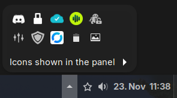
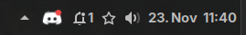
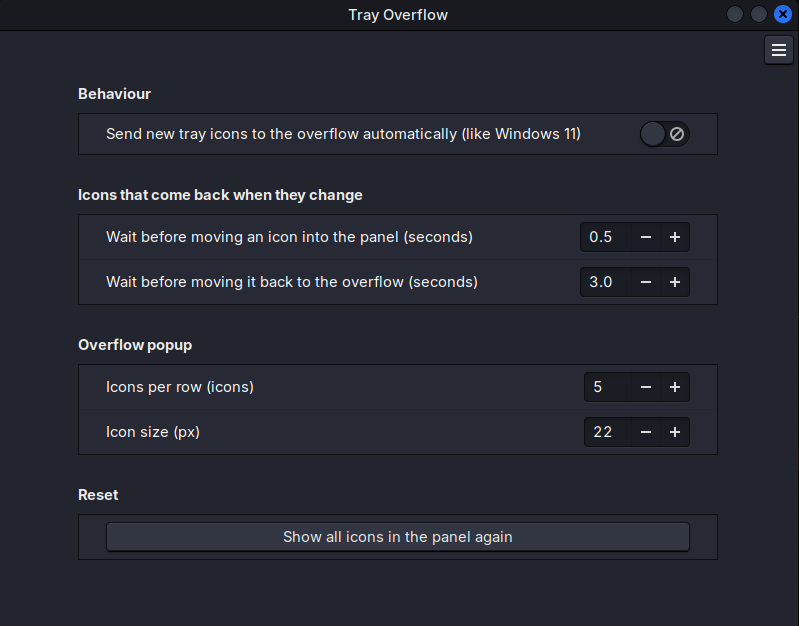

# Tray Overflow

A Cinnamon panel applet that brings the Windows-style **^ tray overflow** to Linux Mint:
choose which tray icons stay in the panel and which are tucked away in a popup.



## Features

- **Hide any tray icon** in a ^ popup. Click hidden icons as usual: left/right click and scrolling are forwarded to the app, and its menu opens while the popup stays open.
- **Per-app switch** "Panel / Hidden", right in the popup or in the applet's right-click menu.
- **Show in panel when its icon changes:** a hidden app moves into the panel when its icon changes (unread badge, updates available …) and goes back once it looks normal again. The applet learns the normal look; in-between states can be ignored. Mint Update is pre-configured.
- **Optional Windows 11 mode:** new tray icons go into the overflow automatically.
- **Works with the stock tray:** it uses Cinnamon's own mechanism to hide icons. Remove the applet and every icon is back.
- **Stable across restarts,** including apps without a proper tray name (Electron apps, Flatpaks, apps that name their icon late).

## Screenshots

**A hidden app comes back when its icon changes** (here: Vesktop with an unread message)



**Choose per app: Panel or Hidden, and whether it comes back on changes**


**Settings**



## Requirements

- Linux Mint (or another distribution) with **Cinnamon**, X11 session
- The stock **XApp Status Applet** on the panel (it's there by default)

Developed and tested on Linux Mint with Cinnamon 6.x.

## Installation

```bash
git clone https://github.com/electricar/tray-overflow.git
cd tray-overflow
./install.sh
```

Or download the latest [release](https://github.com/electricar/tray-overflow/releases), unpack it and run `./install.sh`.

Then:

1. Right-click the panel → **Applets** → add **Tray Overflow**.
2. Turn on panel edit mode and drag the **^** right next to your tray icons.
3. Keep the stock **XApp Status Applet** (and **System Tray**, if present) on the panel; Tray Overflow works together with them.

To update, pull or download the new version and run `./install.sh` again; the applet reloads itself.

## Usage

- Click **^** to see hidden icons.
- Open **Icons shown in the panel** (in the popup or the right-click menu) and set each app to **Panel** or **Hidden**.
- For a hidden app, switch on **↳ Show in panel when its icon changes**. Do it while the icon looks normal (e.g. no unread messages); that look is learned as "normal".
  - While the app is in the panel because of a change: **This look is normal** or **Ignore this look (in-between state)** teach it more looks.
  - **Re-learn** forgets everything learned and takes the current look as normal (useful after an app changes its icon design).

### Settings

| Setting | Default |
|---|---|
| Send new tray icons to the overflow automatically | off |
| Wait before moving an icon into the panel | 0.5 s |
| Wait before moving it back to the overflow | 3 s |
| Icons per row / icon size in the popup | 5 / 22 px |
| Show all icons in the panel again | button |

## How it works

Cinnamon lets applets claim tray icons so the stock tray hides them (that's how the network and sound applets avoid duplicate icons). Tray Overflow claims the icons you hide and draws them itself in its popup, reusing the stock tray's icon monitor. Some apps register their tray icon under a temporary D-Bus name; those are identified by the program behind them, or by their Flatpak app id.

## Limitations

- **Legacy (XEmbed) tray icons** (some Wine and very old apps) can only be hidden completely, not shown in the popup.
- **Nameless tray icons** can only be hidden all together; this is rare.
- Apps whose tray icon has the same generic name share one switch.
- Wayland sessions are untested.

## Troubleshooting

Open Looking Glass (**Alt+F2**, type `lg`, Enter) → **Log** and look for lines starting with `Tray Overflow:`. They list every tray icon found and every hide/restore action. Please include them when opening an issue.

## Credits

Written with the help of Claude (Anthropic). Click forwarding, icon positioning and scroll handling are based on Linux Mint's XApp Status applet.

## License

[GPL-2.0-or-later](LICENSE), like Cinnamon itself.
