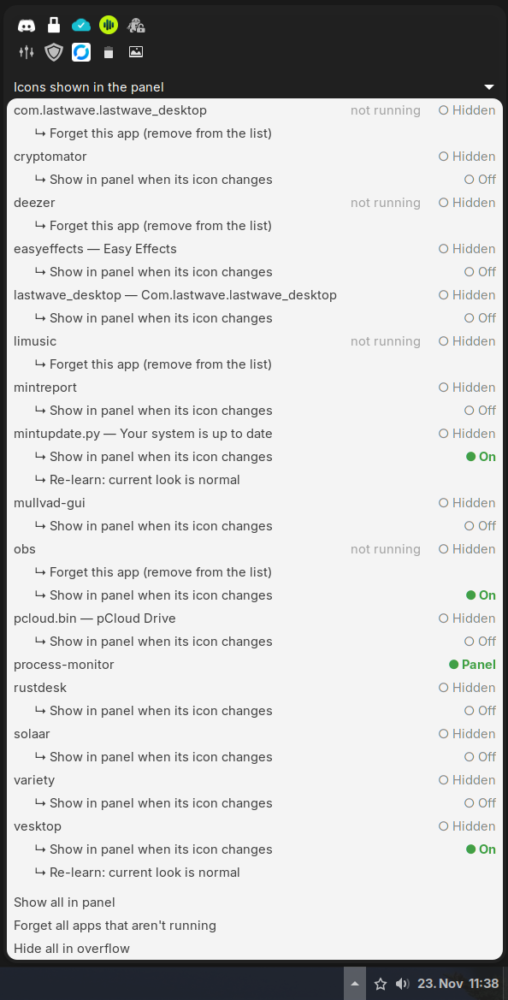

# Tray Overflow

A system tray for Cinnamon with the Windows-style **^ overflow**: choose per app which tray icons stay in the panel and which are tucked away in a popup.


## Features

- **Panel or popup, per app.** Hidden icons work as usual in the popup: left/right click, scrolling, and the app's menu opens while the popup stays open.
- **Show in panel when its icon changes:** a hidden app moves into the panel when its icon changes (unread badge, updates available …) and goes back once it looks normal again. The applet learns the normal look; in-between states can be ignored. Mint Update is pre-configured.
- **Stable across restarts,** also for apps whose tray icon has no proper name (Electron apps, Flatpaks): icons are recognised by the program behind them.
- **No flicker at login:** an icon only appears once it's clear which app it belongs to.
- **Optional Windows 11 mode:** new tray icons go into the overflow automatically.

## Screenshots

**A hidden app comes back when its icon changes** (here: Vesktop with an unread message)


**Choose per app: Panel or Hidden, and whether it comes back on changes**



**Settings**


## Requirements

- Cinnamon (Linux Mint or another distribution)
- Developed and tested on Linux Mint with Cinnamon 6.x

## Installation

Tray Overflow **replaces the "XApp Status Applet"** (Cinnamon's standard tray), so remove that one from the panel.

```bash
git clone https://github.com/electricar/tray-overflow.git
cd tray-overflow
./install.sh
```

Then:

1. Right-click the panel → **Applets**.
2. Remove **XApp Status Applet** from the panel.
3. Add **Tray Overflow** and, in panel edit mode, drag it to where your tray was.

Old-style tray icons (XEmbed: some Wine and very old apps) are not handled by Tray Overflow; they keep appearing in the separate **System Tray** applet, if you have it on the panel.

To update, pull or download the new version and run `./install.sh` again; the applet reloads itself.

## Usage

- Click **^** to see hidden icons.
- Open **Icons shown in the panel** (in the popup, or right-click the ^) and set each app to **Panel** or **Hidden**.
- For a hidden app, switch on **↳ Show in panel when its icon changes**. Do it while the icon looks normal (e.g. no unread messages); that look is learned as "normal".
  - While the app is in the panel because of a change: **This look is normal** or **Ignore this look (in-between state)** teach it more looks.
  - **Re-learn** forgets everything learned and takes the current look as normal (useful after an app changes its icon design).
- **Ctrl + right-click** on any tray icon opens Tray Overflow's own menu.

### Settings

| Setting | Default |
|---|---|
| Send new tray icons to the overflow automatically | off |
| Panel button icon: arrow, three dots or grid, or a custom icon | arrow |
| Show the number of hidden icons next to the button | off |
| Open the popup on hover (closes when the mouse leaves) / delay before opening / before closing | off / 300 ms / 500 ms |
| Wait before moving an icon into the panel | 0.5 s |
| Wait before moving it back to the overflow | 3 s |
| Icons per row / icon size in the popup | 5 / 22 px |
| Write details to the log | off |
| Show all icons in the panel again | button |

## How it works

Tray Overflow is a complete tray: it receives all tray icons through Cinnamon's XApp status icon interface (the same one the XApp Status Applet uses) and places each icon either in the panel or in the popup. Mint's tray service renames relayed icons while apps run (tray title, tray id, connection name), so each icon is identified by the program behind it (or its Flatpak app id), and settings are stored under that.

Icons that another applet shows itself (e.g. the network applet's) are left out, just like in the stock tray.

## Troubleshooting

Turn on **Write details to the log** in the settings, then open Looking Glass (**Alt+F2**, type `lg`, Enter) → **Log** and look for lines starting with `Tray Overflow:`. Please include them when opening an issue.

## Credits

Written with the help of Claude (Anthropic). The panel part (icon display, click and scroll forwarding, recording indicator) is based on Linux Mint's XApp Status applet.

## License

[GPL-2.0-or-later](LICENSE), like Cinnamon itself.
